  

# 🚀 Awesome Code Synchronization & Pair Programming ⚡

  
  
  
  
  
  

---

## 🎯 Top Code Synchronization & Remote Pair Programming Ecosystem

**A curated, production-tested directory of cutting-edge SaaS platforms, Cloud Development Environments (CDEs), and open-source GitHub projects.**  

*Empowering developers with low-latency real-time collaborative coding, CRDT (Conflict-Free Replicated Data Types) and OT (Operational Transformation) state sync, multiplayer IDEs, remote terminal multiplexing, and voice-integrated pairing workflows.*

**Last updated: November 2026**

---

### 🌐 Overview & Core Concepts

Modern software engineering teams, distributed contributors, and open-source maintainers rely on real-time code synchronization to eliminate context switching, speed up code reviews, and onboard engineers seamlessly. This collection indexes tools across four foundational layers:

1. **Multiplayer IDEs & Plugins**: Simultaneous editor buffers, cursor presence, follow mode, and synchronized diagnostics (e.g., VS Code Live Share, Zed, JetBrains Code With Me).
2. **Local-First & CRDT State Engines**: Distributed data structures enabling zero-conflict peer-to-peer real-time document synchronization (e.g., Yjs, Automerge).
3. **Interactive Terminal Multiplexers**: Instant CLI streaming and pair-programming shells running over secure SSH/WebRTC relays (e.g., tmate, Upterm, ttyd).
4. **Cloud Development Workspaces (CDEs)**: Ephemeral, pre-configured development containers accessible via browser or desktop editors (e.g., Replit, Gitpod, Code-Server).

---

## 📑 Table of Contents

- [📊 Sector Overview & Market Dynamics](#-sector-overview--market-dynamics)
- [☁️ SaaS / Hosted Platforms](#️-saas--hosted-platforms)
- [🛠️ Open-Source GitHub Projects](#️-open-source-github-projects)
- [🤝 How to Contribute](#-how-to-contribute)
- [⭐ Star History](#-star-history)
- [💖 Support & Share](#-support--share)
- [⚠️ Disclaimer](#️-disclaimer)

---

## 📊 Sector Overview & Market Dynamics

The global market for developer tools and structured real-time collaboration is estimated at over **$25–$30 billion**, with Cloud Development Environments (CDEs) and collaborative coding representing a high-growth segment expanding at ~18–22% CAGR. The sector displays a dual market dynamic: it is **highly fragmented** among specialized, human-to-human point solutions and niche pair-programming utilities, yet **heavily concentrated** at the underlying platform level where dominant IDE and cloud ecosystems (e.g., Microsoft/GitHub, major cloud providers) exert strong winner-take-all gravity and increasingly bundle native AI-agent pair programming.

---

## ☁️ SaaS / Hosted Platforms

| Platform | Company Size (Revenue / Valuation) | Pricing (Starting Tier) | Free Tier Limits / Free Trial | Description |
| :--- | :--- | :--- | :--- | :--- |
| **[Visual Studio Live Share (Microsoft)](https://microsoft.com)** | ~$3.60T Market Cap (~$245B Ann. Revenue) | $0 / month (Fully free service bundled with VS Code) | Free forever: Capped at 5 concurrent guest participants by default (expandable up to 30 guest participants for classroom/presentation mode); sessions terminate when host disconnects | Cloud-relayed real-time collaborative development service for VS Code enabling shared editing, debugging, terminal sessions, and localhost port forwarding without cloning repos. |
| **[Coscreen (Datadog)](https://coscreen.co)** | ~$56.8B Market Cap (~$2.6B Ann. Revenue) | $15 / host / month (Datadog Pro entry tier; standalone service retired July 31, 2026) | Free tier: 14-day free trial on Datadog with full infrastructure & screen-sharing features (prior standalone free tier offered up to 10 participants per session) | Multi-window collaborative screen-sharing tool allowing engineering teams to share and interact with individual application windows simultaneously. |
| **[Replit Multiplayer](https://replit.com)** | $9.0B Valuation (~$500M ARR) | $20 / month ($240 billed annually for Replit Core) | Free forever (Starter): Basic compute (0.5 vCPU, 512MB RAM), repls sleep after 5 minutes of inactivity, 1 published app limit, and limited daily AI completions | Browser-based cloud IDE offering Google Docs-style real-time multiplayer editing, shared consoles, live previews, and instant deployment. |
| **[Code With Me (JetBrains)](https://jetbrains.com)** | ~$700M+ Ann. Revenue (Bootstrapped, multi-billion implicit valuation) | $19.90 / month (JetBrains IDE individual license; unbundled/sunsetted from standalone sales in 2026) | Free forever (Community): Max 30-minute session duration limit, capped at 3 concurrent guest participants (public relay service supported through Q1 2027) | Collaborative coding and pair-programming service built into JetBrains IDEs featuring voice/video calls, permission controls, and shared code navigation. |
| **[StackBlitz](https://codesandbox.io)** | $700M Valuation (~$40M ARR) | $15 / user / month (StackBlitz Pro tier) | Free forever (Personal): Unlimited public projects, public GitHub repo editing, client-side WebContainers execution; restricted to public repositories only | Instant WebContainers-powered browser IDE providing real-time live-session collaboration, shared terminals, and instant frontend/full-stack preview URLs. |
| **[Gitpod (Ona) Collaborate](https://gitpod.io)** | ~$100M+ Est. Valuation ($41M funding raised, ~$8.6M ARR) | $9 / user / month (Pay-as-you-go / Flex entry tier) | Free forever: 50 hours (500 workspace credits) per month of cloud runtime for public/private repos, limited to standard workspace classes and timeouts | Cloud Development Environment platform supporting live workspace sharing so teammates can join running cloud containers, edit files, and debug together. |
| **[CodeSandbox](https://codesandbox.io)** | ~$50M–$100M Valuation ($15.2M funding raised, acquired by Together AI) | $12 / editor / month ($9/mo billed annually for Pro) | Free forever: Up to 5 workspace members, 400 VM runtime credits/month (~40 hours on Nano VM), and maximum 10 concurrent virtual machines | Instant browser-based development environments providing real-time live-session collaboration, shared terminals, and synchronized preview URLs. |
| **[Tuple](https://tuple.app)** | ~$20M–$40M Est. Valuation (Profitable bootstrapped, $3M–$5M+ ARR) | $30 / user / month ($25/mo billed annually) | 14-day free trial: Full unrestricted access to 5K low-latency screen sharing, dual-cursor control, and audio (only 1 user requires a paid license; guests join free) | Low-latency macOS, Windows, and Linux remote pair-programming app engineered for crisp 5K screen sharing, simultaneous dual-cursor control, and crystal-clear developer audio. |
| **[Pop (formerly Screen)](https://pop.com)** | ~$5M–$10M Est. Valuation (Bootstrapped by Screenhero co-founders) | $25 / user / month (Enterprise tier with SSO/SAML; standard features free during beta) | Free forever (Starter / Beta): Free standard account with unlimited meetings, simultaneous multi-cursor control, screen annotation, and low-latency audio/video | Multiplayer screen-sharing and remote pair-programming workspace featuring multi-cursor control, drawing annotations, and low-latency audio/video. |
| **[Floobits (Legacy Cloud Collaboration)](https://floobits.com)** | Early VC-backed ($150K raised via Y Combinator; inactive/legacy) | $9 / month (Starting paid tier for private workspaces) | Free forever: Unlimited public workspaces with real-time multi-editor cursor tracking, restricted strictly to public visibility with up to 3 concurrent participants | Early cross-editor real-time collaborative coding service connecting Sublime Text, Atom, Emacs, Neovim, and IntelliJ workspaces via cloud sync servers. |

---

## 🛠️ Open-Source GitHub Projects

*Sorted in descending order by GitHub Stars ⭐. Star badges link directly to each project's stargazers community page.*

1. **[RustDesk (`rustdesk/rustdesk`)](https://github.com/rustdesk/rustdesk)**   
   Open-source virtual remote desktop client and server software written in Rust. Designed for full self-hosting with end-to-end encryption, multi-monitor display, and low-latency control, serving as a self-hosted alternative to TeamViewer and AnyDesk for remote pair programming.

2. **[Zed (`zed-industries/zed`)](https://github.com/zed-industries/zed)**   
   High-performance, GPU-accelerated multiplayer code editor engineered in Rust by the creators of Atom and Tree-sitter. Features native real-time multi-buffer collaboration, simultaneous typing, shared terminal channels, screen sharing, and integrated low-latency voice calling.

3. **[Code-Server (`coder/code-server`)](https://github.com/coder/code-server)**   
   Enables developers to run upstream VS Code on any remote Linux machine, cloud instance, or Docker container and access it securely through any modern web browser with full extension and terminal support.

4. **[Lapce (`lapce/lapce`)](https://github.com/lapce/lapce)**   
   Lightning-fast open-source code editor written in pure Rust with a GPU-rendered UI (Floem), built-in terminal, remote backend architecture, and native LSP syntax highlighting designed for speed and distributed editing.

5. **[Yjs (`yjs/yjs`)](https://github.com/yjs/yjs)**   
   The industry-standard CRDT (Conflict-Free Replicated Data Type) framework powering collaborative editing across the web. Provides high-performance shared data types with automatic conflict resolution, driving real-time collaboration bindings for Monaco, CodeMirror, Quill, and ProseMirror.

6. **[Neko (`m1k1o/neko`)](https://github.com/m1k1o/neko)**   
   A self-hosted virtual browser and desktop running inside Docker that utilizes WebRTC for multi-user screen streaming, shared keyboard/mouse control, and synchronized web application testing.

7. **[Etherpad (`ether/etherpad-lite`)](https://github.com/ether/etherpad-lite)**   
   Real-time collaborative document and code scratchpad engine based on Operational Transformation (OT), enabling highly customizable multi-user editing with rich plugin ecosystems and revision time-sliders.

8. **[ttyd (`tsl0922/ttyd`)](https://github.com/tsl0922/ttyd)**   
   Simple, high-performance command-line tool for sharing Linux/Unix terminal sessions over WebSockets into any modern browser, complete with full C/C++ speed and SSL support.

9. **[HedgeDoc (`hedgedoc/hedgedoc`)](https://github.com/hedgedoc/hedgedoc)**   
   Self-hosted, real-time collaborative Markdown editor and scratchpad allowing software engineers and technical interviewers to synchronize diagrams, architecture notes, and code snippets simultaneously.

10. **[Automerge (`automerge/automerge`)](https://github.com/automerge/automerge)**   
    A JSON-like CRDT data structure library written in Rust with JavaScript/Wasm bindings, engineered for local-first software, offline-capable applications, and conflict-free peer-to-peer data synchronization.

11. **[OpenVSCode Server (`gitpod-io/openvscode-server`)](https://github.com/gitpod-io/openvscode-server)**   
    Upstream VS Code server architecture maintained by Gitpod that runs cleanly on remote machines and renders interactive development sessions in the browser without modifications.

12. **[tmate (`tmate-io/tmate`)](https://github.com/tmate-io/tmate)**   
    Instant terminal sharing utility forked from tmux that generates secure SSH links and read-only or read-write web URLs for instant pair programming in the command line.

13. **[PartyKit (`partykit/partykit`)](https://github.com/partykit/partykit)**   
    Open-source edge runtime framework built for developing multiplayer apps, real-time presence rooms, and collaborative code synchronization using WebSockets and serverless edge compute.

14. **[Mutagen (`mutagen-io/mutagen`)](https://github.com/mutagen-io/mutagen)**   
    High-speed, bi-directional file synchronization and network forwarding tool in Go designed to synchronize local source code modifications to remote pairing hosts and containers in real time.

15. **[GoTTY (`sorenisanerd/gotty`)](https://github.com/sorenisanerd/gotty)**   
    Simple Go-based CLI utility that turns your local command-line tools and terminal sessions into a live collaborative web application.

16. **[Teletype for Atom (`atom/teletype`)](https://github.com/atom/teletype)**   
    The landmark peer-to-peer WebRTC collaborative code editing package created by GitHub that popularized decentralized CRDT buffer synchronization across developer workspaces.

17. **[Codync (`leepokai/Codync`)](https://github.com/leepokai/Codync)**   
    Open-source Rust-based bot and live agent coordination utility for messaging Claude Code, Codex, Gemini CLI, Cursor, and 40+ AI agents directly on workstations across desktop and mobile.

18. **[instant.nvim (`jbyuki/instant.nvim`)](https://github.com/jbyuki/instant.nvim)**   
    Lightweight, pure-Lua collaborative editing plugin for Neovim that enables real-time peer-to-peer buffer synchronization with cursor tracking and multi-client edits.

19. **[Upterm (`owenthereal/upterm`)](https://github.com/owenthereal/upterm)**   
    Modern, secure open-source terminal sharing utility written in Go. Securely connects terminal sessions over SSH with GitHub public-key authentication for interactive pairing.

20. **[tty-share (`elisescu/tty-share`)](https://github.com/elisescu/tty-share)**   
    Zero-configuration terminal sharing tool that streams terminal sessions via browser links or direct terminal-to-terminal connections with end-to-end encryption.

21. **[live-share.nvim (`azratul/live-share.nvim`)](https://github.com/azratul/live-share.nvim)**   
    Neovim collaborative pair-programming plugin inspired by VS Code Live Share, enabling real-time remote pairing sessions over instantaneous SSH/relay tunnels.

22. **[Saros (`saros-project/saros`)](https://github.com/saros-project/saros)**   
    Open-source distributed collaborative software development plugin for Eclipse and IntelliJ supporting multi-user editing, follow mode, and project synchronization.

---

## 🤝 How to Contribute

Contributions, feature suggestions, and new project listings are warmly welcomed! 🌟

1. 🍴 **Fork the repository** on GitHub.
2. 🌿 **Create a new branch**: `git checkout -b feature/add-new-tool`.
3. 📝 **Add your entry** under the appropriate category (`SaaS` or `Open-Source`).
   - For open-source repos, provide the full repository identifier and badge link.
   - For SaaS platforms, provide specific pricing, free limits, and valuation/scale details.
4. 🚀 **Commit your changes**: `git commit -m "Add <tool_name> to collaborative ecosystem"`.
5. 📤 **Submit a Pull Request** with a concise description explaining why the tool is valuable.

---

## ⭐ Star History

---

## 💖 Support & Share

If you find this curated pair programming and code synchronization directory helpful, please consider supporting the project:

- ⭐ **Star this repository** to help other developers and engineering teams discover it.
- 🍴 **Fork & Share** it with your engineering team, peers, or community on [X (Twitter)](https://twitter.com), [LinkedIn](https://linkedin.com), and [Reddit](https://reddit.com).
- ☕ **Buy me a coffee / Sponsor** my open-source work on the [GitHub Sponsor Dashboard](https://github.com/sponsors/ishandutta2007) — featuring tiers for profile badges, README shoutouts, corporate logo placements, and prioritized project reviews!

  

---

## ⚠️ Disclaimer

- This is a community-curated, non-commercial list intended for educational and technological reference.
- Live pair-programming and terminal-sharing utilities (`tmate`, `Upterm`, `Live Share`) can grant remote participants shell, process, or local network access; always run sessions with read-only permissions unless full write access is required.
- Historical note: `Teletype for Atom` was archived alongside Atom, but its peer-to-peer CRDT implementation remains a foundational architectural reference for modern collaborative editors.

---

  <b>Built with ❤️ for remote developers, open-source maintainers, coding mentors, and collaborative devtool builders worldwide.</b>

